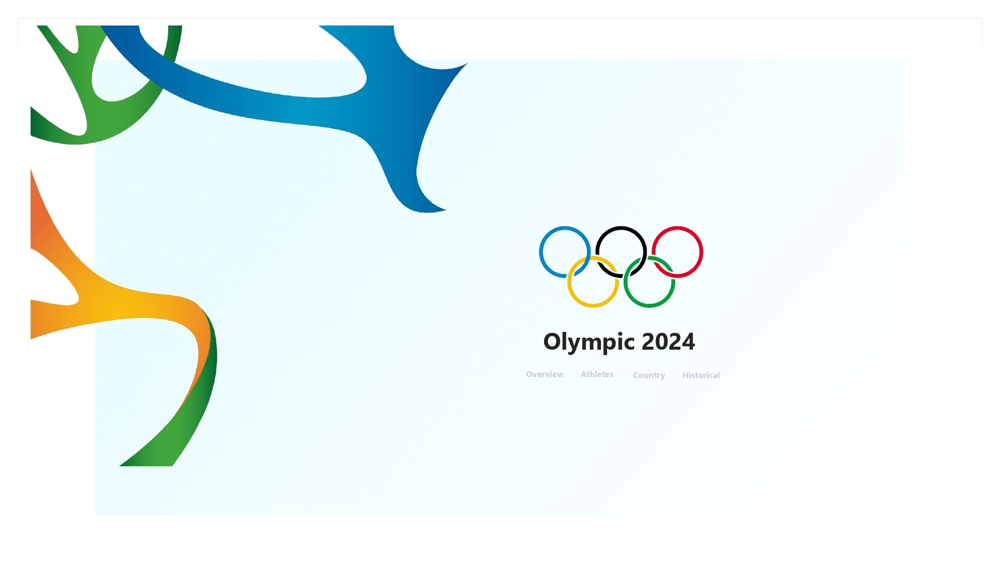
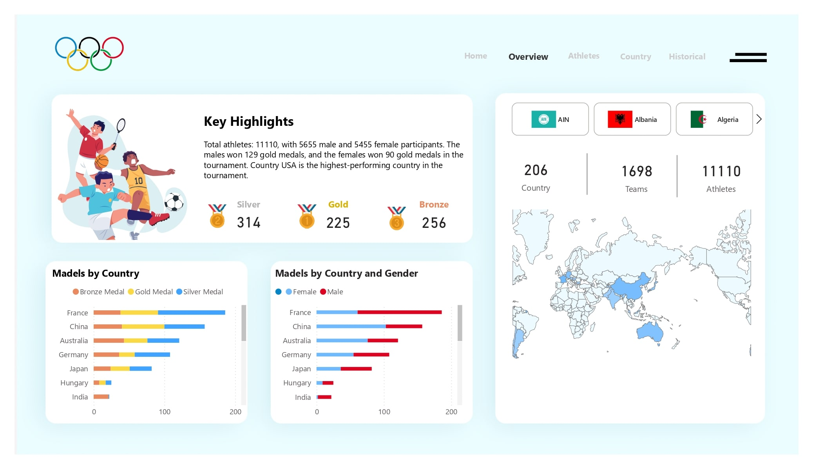
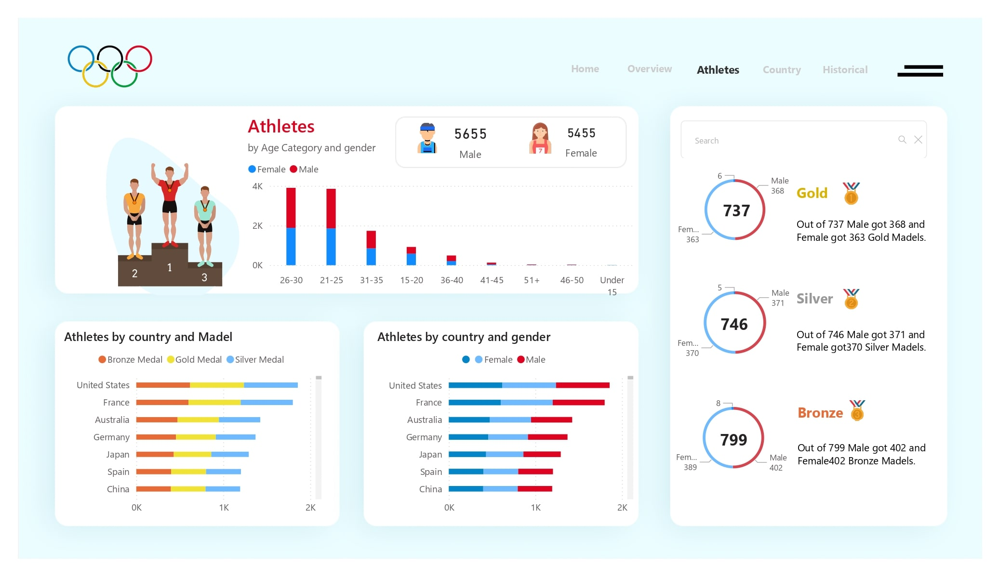
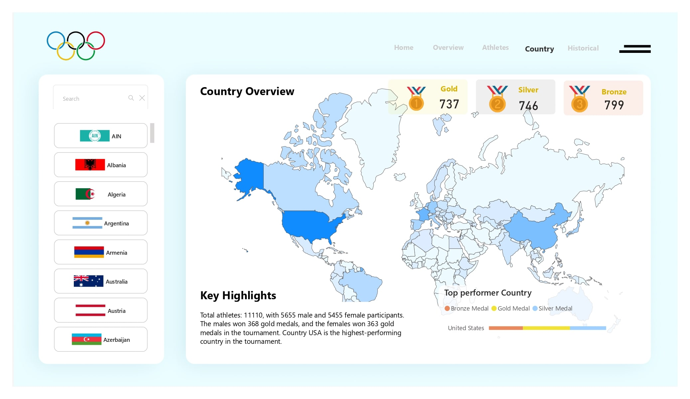
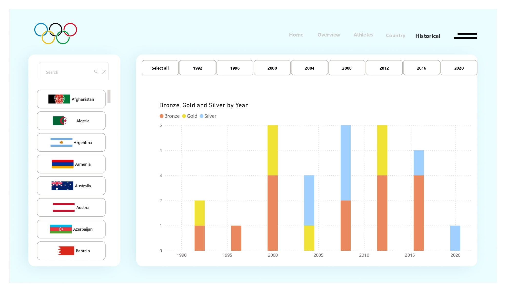

**[GitHub Repository](https://github.com/U77w41/Power-BI-Dashboards/tree/main/Olympic-2024-Dashboard)** · **[Kaggle Dataset](https://www.kaggle.com/datasets/piterfm/paris-2024-olympic-summer-games)**

## Overview

The Paris 2024 Summer Olympic Games featured over 10,500 athletes competing across 32 sports and 329 medal events. This Power BI dashboard aggregates competition records into interactive views exploring country medal tallies, gender parity in podium finishes, individual athlete records, and multi-year historical trends.

The report contains five interconnected pages with dynamic cross-filtering by sport, country, and event.

## Dashboard Pages

### 1. Home & Navigation

The landing screen provides a high-level visual intro and direct navigation links across the four core analytical modules.

### 2. Medal Overview & Geographic Distribution

This page summarizes total medal counts, gold-to-bronze distributions, and global medal density.

* **Medals by Country & Gender:** Stacked bar charts showing the balance of medals won by male and female athletes across participating nations.
* **Choropleth Map:** Visualizes medal density worldwide, highlighting regional strongholds in specific athletic disciplines.
* **Game-Wise Slicers:** Allows filtering all charts simultaneously by selecting individual sports (e.g., Athletics, Swimming, Gymnastics).

### 3. Athlete Performance & Disciplines

A dedicated athlete directory exploring individual performances, multiple medalists, and sport-specific achievements.

* **Athlete Roster:** Searchable table listing athletes with their nationality, events entered, and medal outcomes.
* **Multi-Medal Winners:** Highlights top competitors who secured podium placements across multiple individual or team events.
* **Filters:** Drill down by country, sporting discipline, gender, or medal type.

### 4. Country Profiles

An in-depth breakdown of individual National Olympic Committees (NOCs) and their medal composition.

* **National Leaderboard:** Compares official IOC ranking (sorted by gold medal priority) with total medal count.
* **Discipline Strengths:** Identifies which sports contributed the largest share of a country's total medal haul.
* **Podium Conversion:** Visualizes the ratio of finals reached to medals won.

### 5. Historical Context & Multi-Games Trends

Places Paris 2024 in context by comparing national performance against historical Olympic Games.

* **Historical Medal Trajectories:** Line charts tracking how nations have trended over multiple modern Olympic editions.
* **Emerging Contenders:** Flags countries achieving their first-ever Olympic medals or record-high medal totals in 2024.

## Key DAX Measures

* **Total Medals:** `COUNTROWS(Medals)`
* **Gold Medal Ratio:** `DIVIDE(CALCULATE(COUNTROWS(Medals), Medals[Medal] = "Gold"), [Total Medals], 0)`
* **Weighted Medal Score:** `CALCULATE(COUNTROWS(Medals), Medals[Medal] = "Gold") * 3 + CALCULATE(COUNTROWS(Medals), Medals[Medal] = "Silver") * 2 + CALCULATE(COUNTROWS(Medals), Medals[Medal] = "Bronze")`

## Data Sources

* **Competition Data:** [Paris 2024 Olympic Summer Games Dataset on Kaggle](https://www.kaggle.com/datasets/piterfm/paris-2024-olympic-summer-games)
* **Historical Records:** Official Olympic database references via [Olympics.com](https://olympics.com/en/paris-2024)
