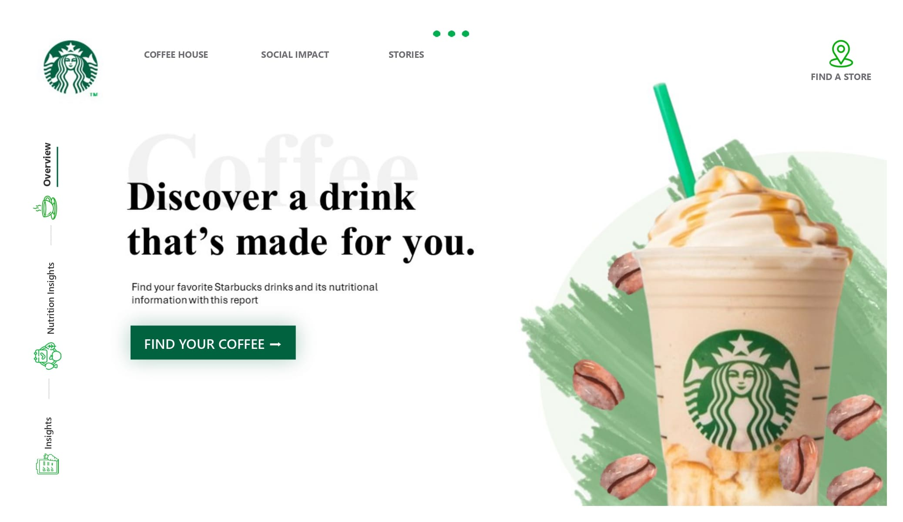
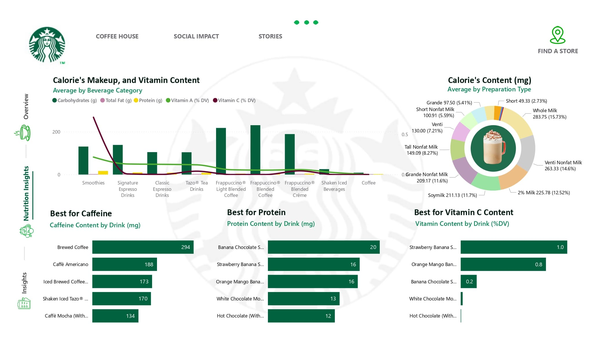
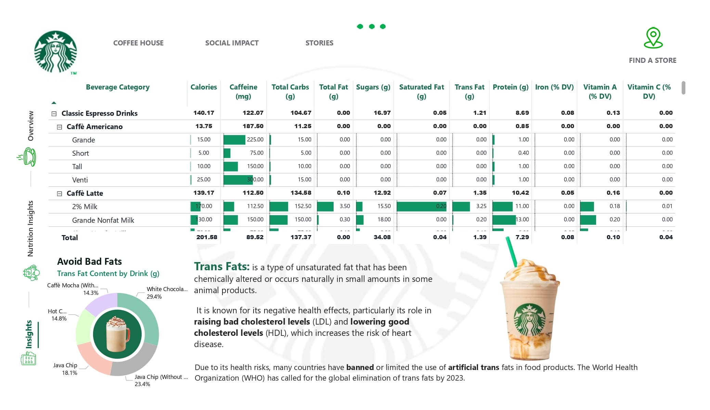
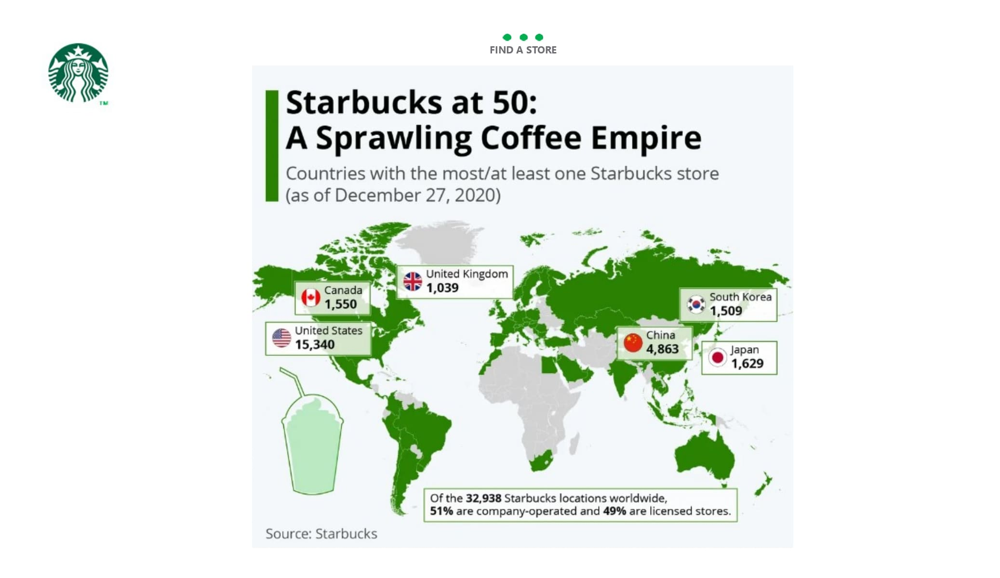

**[GitHub Repository](https://github.com/U77w41/Power-BI-Dashboards/tree/main/Starbucks-Drinks-Dashboard)**

> **Note on Data:** This project was developed as an exploratory data visualization study using simulated beverage metrics and location data to model commercial nutritional reporting.

## Overview

Modern beverage menus span hundreds of customized variations across milk bases, sweeteners, and portion sizes. This Power BI dashboard provides structured reporting on beverage nutrition, breaking down calorie counts, sugar loads, macronutrient splits, and global store presence across four analytical pages.

## Dashboard Pages

### 1. Beverage Portfolio Overview

The introductory page provides an aggregate view of the beverage menu across major drink categories (Espresso, Brewed Coffee, Frappuccino, Tea, and Cold Brew).

* **Menu Composition:** Distribution of drink offerings by category and available cup sizes (Short, Tall, Grande, Venti).
* **Macronutrient Averages:** Baseline calorie, protein, fat, and carbohydrate levels averaged by beverage line.
* **Top Ranks:** Quick-reference cards highlighting beverages with the highest and lowest calorie counts per category.

### 2. Nutritional Profiles & Macronutrients

A comparative view breaking down primary dietary macronutrients across drinks.

* **Fat and Protein Comparisons:** Scatter plots and grouped bar charts comparing protein content against total fat across dairy and plant-based milk formulations.
* **Serving Size Normalization:** Visualizations that adjust metric comparisons based on fluid volume (caloric density per ounce).
* **Category Slicers:** Interactive filters enabling users to compare specific drink subcategories side-by-side.

### 3. Critical Health Indicators & Sugar Mapping

Focuses on dietary risk factors that consumers and health analysts monitor closely: added sugars, sodium, trans fats, and caffeine.

* **Sugar Content Distribution:** Identifies beverages that exceed recommended daily sugar intakes in a single serving.
* **Trans & Saturated Fat Flags:** Highlights drinks with elevated saturated fat levels resulting from whipped cream or whole milk preparations.
* **Color-Coded Thresholds:** Conditional formatting on tables and KPI cards flagging nutritional extremes.

### 4. Store Distribution Map

Visualizes store network coverage across international territories.

* **Global Footprint:** Geographic plot showing store concentrations across regions.
* **Regional Aggregation:** Drill-down from continent and country to local market clusters.

## Key DAX Calculations

* **Average Calories per Drink:** `AVERAGE(Beverages[Calories])`
* **Sugar-to-Calorie Ratio:** `DIVIDE(SUM(Beverages[Sugars_g]) * 4, SUM(Beverages[Calories]), 0)`
* **High-Sugar Flag:** `IF(Beverages[Sugars_g] > 30, "Above 30g", "30g or Below")`
