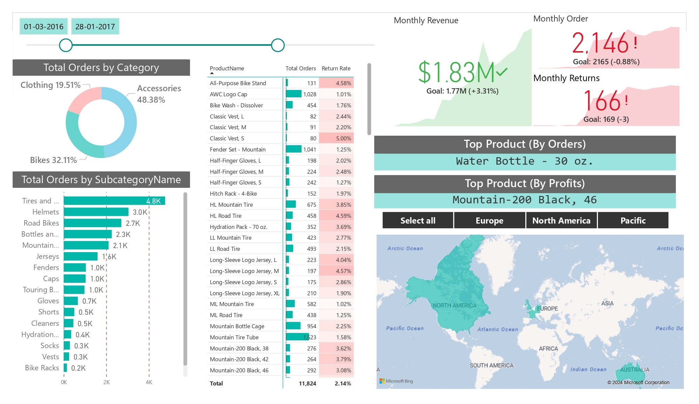
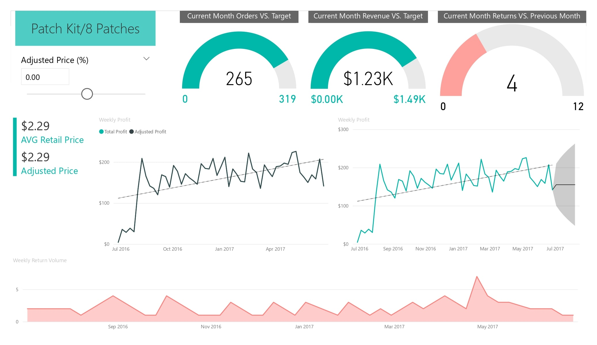
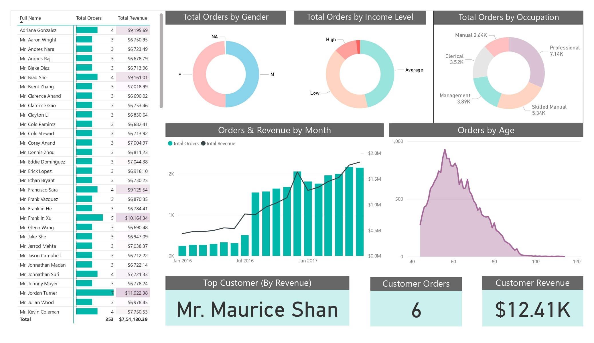

**[GitHub Repository](https://github.com/U77w41/Power-BI-Dashboards/tree/main/Visualizing-Microsoft-AdventureWorks-Data)**

## Overview

AdventureWorks is Microsoft's standard relational sample database representing a multinational bicycle manufacturing and retail company. This Power BI dashboard tracks commercial performance across products, sales territories, and customer segments, turning transactional sales records into operational reporting.

The report is organized into three focused pages covering sales volume, target tracking, and customer demographics.

## Dashboard Pages

### 1. Sales Overview

The executive overview summarizes top-line revenue, order counts, return rates, and product category distribution.

* **Revenue by Category:** Breaks down total sales across Bikes, Components, Clothing, and Accessories.
* **Geographical Distribution:** Maps revenue across sales regions in North America, Europe, and Australia.
* **Returns Tracking:** Highlights product categories with above-average return rates to identify potential quality or fulfillment issues.
* **Dynamic Slicers:** Allows filtering by product category, subcategory, territory, and transaction date range.

### 2. Performance Metrics & Target Tracking

This view compares actual monthly operational figures against management targets to monitor pacing and profitability.

* **Actual vs. Target KPIs:** Gauge charts and status cards comparing current-month performance against budgeted targets for orders, revenue, and returns.
* **Trend Analysis:** Weekly rolling profit and revenue trendlines tracking seasonal fluctuations and growth trajectory.
* **Variance Indicators:** Color-coded KPI cards indicating whether key metrics are ahead or behind scheduled goals.

### 3. Customer Analytics & Segmentation

The customer intelligence page analyzes purchasing habits across demographic attributes to profile core customer cohorts.

* **Income and Occupation:** Revenue distribution across annual income brackets and professional occupations (Management, Professional, Skilled Manual, Clerical).
* **Demographic Breakdown:** Customer segmentation by age group, marital status, and gender.
* **Purchase Frequency:** Tracks average spend per customer and order repetition rates.

## Data Model & DAX Measures

The underlying data model follows a star schema connecting transactional fact tables (`Sales` and `Returns`) to dimension tables (`Customer`, `Product`, `Territory`, and `Calendar`).

Key DAX measures include:

* **Total Revenue:** `SUMX(Sales, Sales[OrderQuantity] * Sales[UnitPrice])`
* **Total Profit:** `[Total Revenue] - SUMX(Sales, Sales[OrderQuantity] * Sales[TotalProductCost])`
* **Return Rate %:** `DIVIDE(COUNT(Returns[ReturnQuantity]), COUNT(Sales[OrderQuantity]), 0)`
* **Revenue Variance to Target:** `[Total Revenue] - [Target Revenue]`

Cross-filtering is enabled across all visualizations, and users can drill down from parent product categories into specific product models.

## Data Source

* **Dataset:** [Microsoft AdventureWorks Sample Data](https://learn.microsoft.com/en-us/sql/samples/adventureworks-install-configure?view=sql-server-ver16&tabs=ssms)
